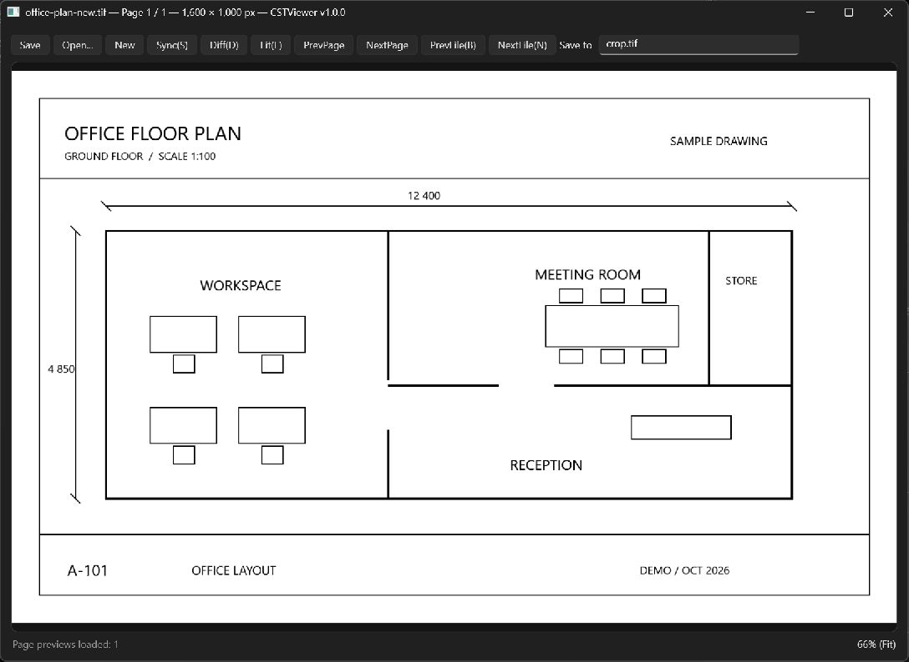
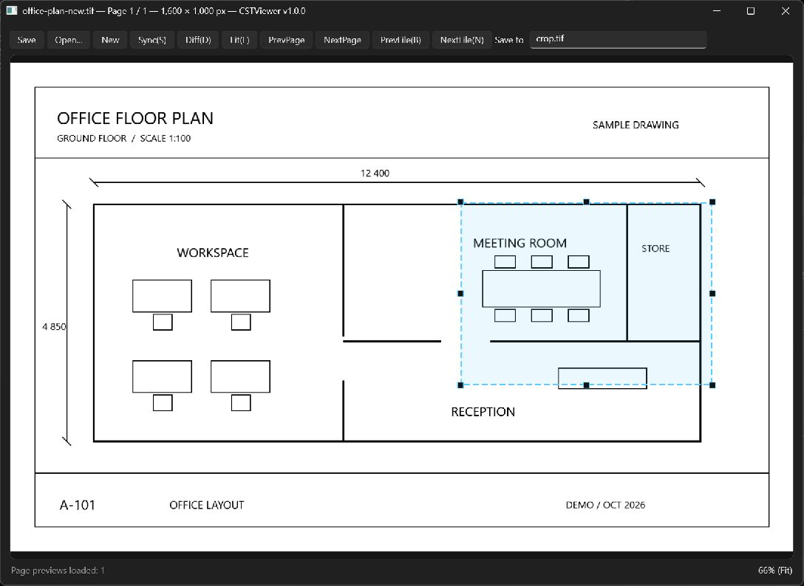
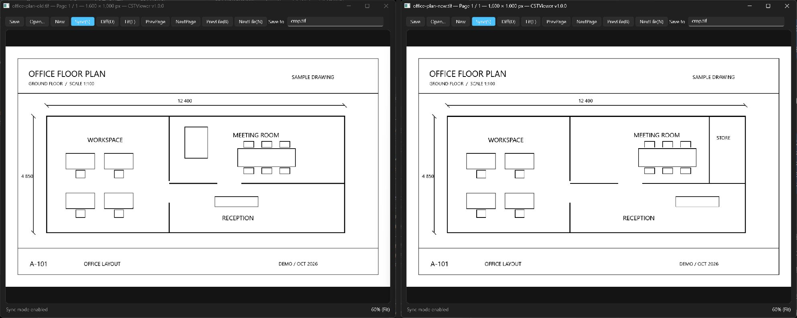
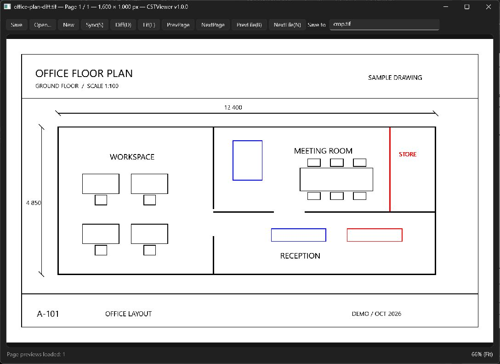

# CSTViewer

**1. Basic view**



**2. Crop selection (right drag)**



**3. Side-by-side Sync**



**4. Image diff (red: added, blue: removed)**



CSTViewer is a fast image viewer for Windows 11, built with C# and .NET 10 (WPF). It is a rewrite of the Python TIFF viewer, focused on responsive navigation and viewing large images.

## Features

- View multipage TIFFs, including BigTIFF, plus PNG, JPEG, BMP, and GIF (first frame).
- Load previews quickly, preload TIFF pages, and show more detail when zooming.
- Open images by drag and drop, file dialog, or command-line arguments.
- Compare two windows side by side with synchronized zoom, pan, and navigation.
- Generate image diffs with additions in red and deletions in blue.
- Select, save, and copy image regions to the clipboard.
- Copy the entire source file to the desktop with the **Save** button.

## Run

Requires Windows 11 (x64) and the .NET 10 SDK. TIFF support uses bundled NetVips/libvips libraries; no Python installation is required.

```powershell
dotnet run --project .\CSTViewer\CSTViewer.csproj
```

To open an image at startup:

```powershell
dotnet run --project .\CSTViewer\CSTViewer.csproj -- "C:\images\sample.tif"
```

## Controls

| Action | Control |
| --- | --- |
| Zoom / pan | Mouse wheel / left drag |
| Fit image / trim window margins | F |
| Previous / next TIFF page | Page Up / Page Down |
| Previous / next TIFF file in the folder | B / N |
| New window / toggle synchronization | Ctrl+Shift+N / S |
| Generate a diff (current window is the new image) | D |
| Select a region / save and copy it | Right drag / click inside the selection |
| Copy selection / clear selection | Ctrl+C / Esc |

Use **Save to** to choose the destination for crops and diffs.

## Tests

```powershell
dotnet test .\CSTViewer\CSTViewer.slnx
```
