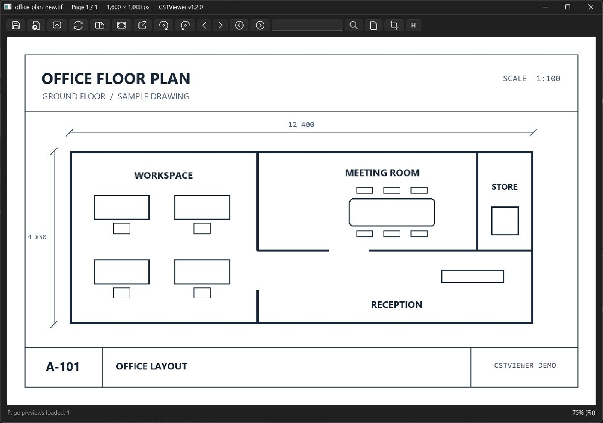
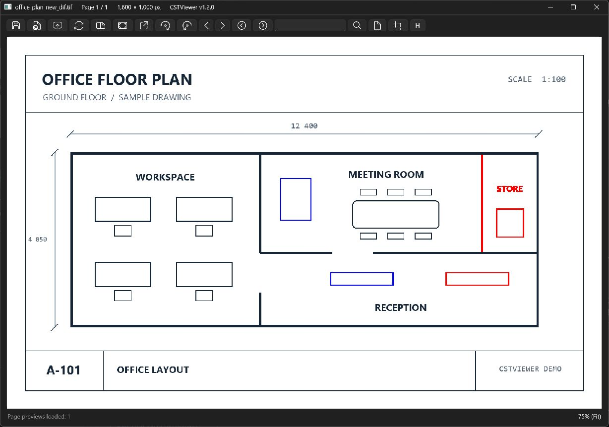

# CSTViewer

**1. Basic view**



**2. Crop selection (right drag)**


**3. Side-by-side Sync**


**4. Image diff (red: added, blue: removed)**



CSTViewer is a fast image viewer for Windows 11, built with C# and .NET 10 (WPF). It is a rewrite of the Python TIFF viewer, focused on responsive navigation and viewing large images.

## Features

- View multipage TIFFs, including BigTIFF, plus PNG, JPEG, BMP, GIF, and WebP. Animated GIF and WebP images display the first frame.
- Use two image states: a lightweight preview and a cached detail image at 1.8 times the current display resolution, capped at the source resolution. Refine the visible TIFF area with a 50% margin on each side first, then generate the entire current page at the same required resolution in the background.
- Prioritize page previews over full-page refinement. Visible-area refinement remains available during preloading; full-page refinement starts after preview preloading finishes.
- Reuse cached detail images for panning and zooming, upgrading them only when their resolution is insufficient. At Fit, the first detail image already covers the entire page, so a second full-page decode is skipped. Retain generated detail images for all pages in the open file, without a page-count limit. Cache up to 64 preview pages and 16 pages of mipmaps, without byte-size limits. Monochrome TIFFs continue to use 8-bit grayscale display images.
- Use only the lightweight preview while zooming, then restore cached detail after 220 ms without wheel input, matching the Python viewer.
- Restore detail independently of the 1.8-times refinement target: use available detail that improves on the preview immediately after zooming, even when more pixels are still needed, and continue refinement in the background.
- Open images by drag and drop, file dialog, or command-line arguments.
- Navigate all supported image formats in the same folder with the previous and next file buttons or Q and W.
- Rotate the displayed page 90° right or left (R / L). Each page keeps its own viewing angle while the file is open; other pages and the original file remain unchanged.
- Automatically size the window to the rotated image using the startup sizing rules until the window is manually resized. Keep side-by-side Sync layouts unchanged.
- Use compact Fluent toolbar icons with shortcuts listed in their tooltips.
- Compare two windows side by side with synchronized zoom, pan, navigation, and 90° rotation. R / L rotates the currently displayed page in each window by the same amount.
- Generate image diffs with additions in red and deletions in blue.
- Search drawing text across all pages of an open TIFF with OCR and highlight matches on the current page with translucent red shading.
- Show recognized text from every TIFF page in a separate window. The status bar shows progress during search and OCR.
- Select, save, and copy image regions to the clipboard.
- Copy the entire source file to the desktop with the **Save** button.

## Run

Requires Windows 11 (x64) and the .NET 10 SDK. TIFF and WebP support use the bundled NetVips/libvips libraries; no Python installation is required.

TIFF text search uses an external Tesseract 5 installation. Install it in `%ProgramFiles%\Tesseract-OCR` or set `CSTVIEWER_TESSERACT_DIR` to the folder that contains `tesseract.exe`. The installation needs its DLLs, `tessdata\eng.traineddata`, `tessdata\jpn.traineddata`, `tessdata\osd.traineddata`, and `tessdata\configs\tsv`.

```powershell
dotnet run --project .\CSTViewer\CSTViewer.csproj
```

To open an image at startup:

```powershell
dotnet run --project .\CSTViewer\CSTViewer.csproj -- "C:\images\sample.tif"
```

## Controls

| Action | Control |
| --- | --- |
| Zoom / pan | Mouse wheel / left drag |
| Fit image / trim window margins | F |
| Toggle window resizing with mouse wheel zoom | A |
| Rotate displayed page 90° right / left | R / L |
| Previous / next TIFF page | Page Up or 1 / Page Down or 2 |
| Previous / next supported image file in the folder | Q / W |
| New window / toggle synchronization | Ctrl+Shift+N / S |
| Generate a diff (current window is the new image) | D |
| Search TIFF text | Enter in the search box or click the magnifying glass |
| Show OCR results for all TIFF pages | Click the OCR button next to the magnifying glass |
| Select a region / save and copy it | Right drag / click inside the selection |
| Copy selection / clear selection | Ctrl+C / Esc |

Click the **Save to** crop icon, enter the destination for crops and diffs in the window that opens, and select **OK**.

## Tests

```powershell
dotnet test .\CSTViewer\CSTViewer.slnx
```
