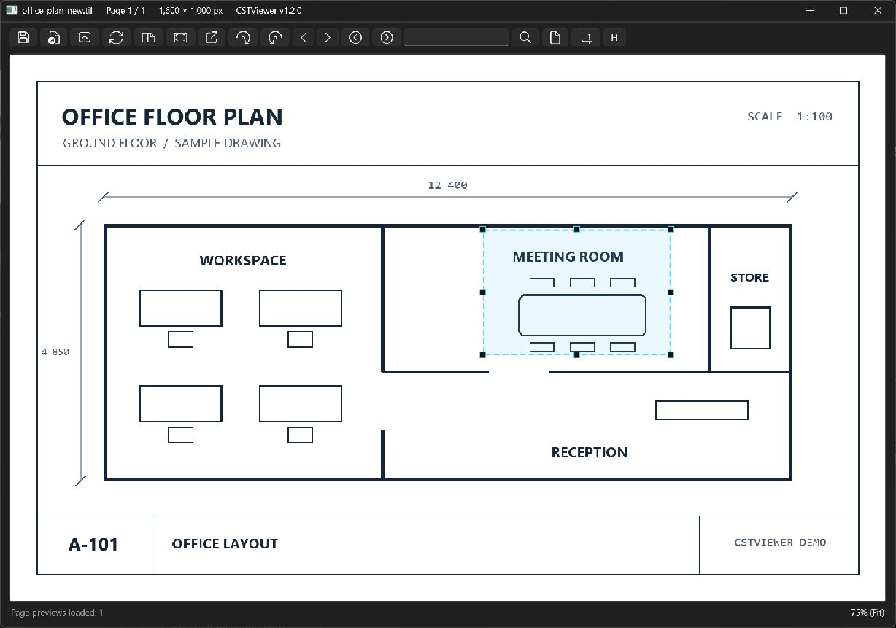
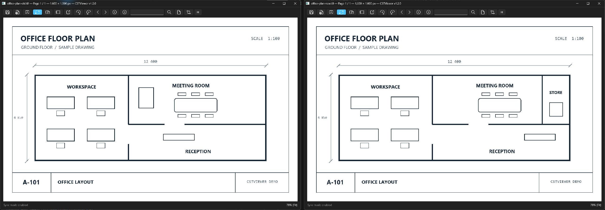

# CSTViewer

CSTViewer is a fast Windows 11 image viewer for technical drawings, built with C# and .NET 10 (WPF). It supports multipage TIFFs, generates TIFF diff files that highlight additions and deletions, and lets you crop and save selected regions. Sync mode links zoom, pan, and navigation in two side-by-side windows. Built-in OCR lets you search across all TIFF pages and view the recognized text.

## Features

- **Image formats and navigation.** View multipage TIFFs, including BigTIFF, plus PNG, JPEG, BMP, GIF, and WebP. Animated GIF and WebP images display the first frame. Open images by drag and drop, the file dialog, or command-line arguments. Browse supported images in the same folder with the previous and next file controls.
- **Zoom and rotation.** Zoom around the pointer, pan, or fit the entire image. Optionally resize the window as you zoom with the wheel. Rotate the displayed page 90° in either direction. Each page retains its viewing angle while the file is open. Before a manual resize, a window in normal view can resize automatically when the page orientation changes.
- **Side-by-side Sync.** Arrange two viewer windows on the same monitor and synchronize zoom, pan, page and file navigation, and rotation. Rotation applies the same 90° step to the displayed page in each window. Select **Sync** again to turn synchronization off.
- **Image comparison.** With both images open, run **Compare** from the newer image's window. CSTViewer compares all pages against the image in the nearest other visible viewer window and shows progress in the status bar. It saves the result as a BigTIFF and opens it in a new window. Additions appear in red and deletions in blue.
- **TIFF text search and OCR.** Search all pages of the open TIFF for recognized text. Translucent red highlights mark matches on the displayed page. The status bar reports the number of matches and how many pages contain them. The adjacent **OCR** button opens the recognized text for every page in a separate window. Both operations use bundled Tesseract 5 with English and Japanese recognition, including vertical Japanese, and show progress in the status bar.
- **Crop and save.** Select a region to save and copy to the clipboard. Crops use the source file format, with lossless encoding for WebP. The **Save** button copies the entire source file to the desktop under its original name. Ctrl+click **Save** or press Ctrl+S to choose a folder and filename. The dialog opens on the desktop with the original filename, and the app asks before overwriting an existing file.
- **In-app help.** Click the **H** toolbar button for a guide to the toolbar, shortcuts, cropping, and mouse controls in English or Japanese.

### Large-image rendering

CSTViewer loads TIFF pages at 1.8 times the initial fit resolution, up to the source resolution. It displays the first page as soon as it is ready and preloads the remaining pages at the same quality. During wheel zoom, CSTViewer uses the initial TIFF page image. To keep the image that was visible when the gesture began, select **Keep detail while zooming TIFFs** in the notification area menu. The setting applies until CSTViewer exits. After 220 ms without wheel input, CSTViewer restores usable cached detail and refines the image if the new view requires more resolution.

For TIFFs, CSTViewer first refines the visible area, then adds a margin of 50% on each side for panning, followed by the full page. Page preview preloading takes priority over margin and full-page refinement. At Fit, a detail image that already covers the page also serves as the full-page image. CSTViewer retains generated full-page detail images for the open file and caches up to 64 preview pages and 16 pages of mipmaps. Monochrome TIFFs use 8-bit grayscale display images.

## Run

CSTViewer runs on Windows 11 (x64). Framework-dependent builds require the .NET 10 Desktop Runtime (x64). Open `CSTViewer.exe` from the published folder and keep the bundled `Tesseract-OCR` folder next to it. TIFF and WebP use the bundled NetVips/libvips libraries.

To run from a source checkout, install the .NET 10 SDK and run this command from the repository root.

```powershell
dotnet run --project .\CSTViewer\CSTViewer.csproj
```

Pass one or more paths after `--` to open each image in its own window.

```powershell
dotnet run --project .\CSTViewer\CSTViewer.csproj -- "C:\images\first.tif" "C:\images\second.tif"
```

After the last viewer window closes, CSTViewer stays in the Windows notification area. Double-click its icon or choose **Open CSTViewer** from the icon's menu to bring up a viewer. Choose **Exit** from that menu to quit. Launching CSTViewer again with image paths opens them in the running application.

## Controls

| Action | Control |
| --- | --- |
| Open an image | **Open** button or drag and drop an image file |
| Choose where to save the original image file | Ctrl+click **Save** or Ctrl+S |
| Zoom around the pointer | Mouse wheel |
| Move the window in Fit mode | Left-drag the image outside the crop selection. During side-by-side Sync, drag the title bar. |
| Pan the zoomed image | Left-drag outside the crop selection |
| Fit the entire image or trim margins when already fitted | F |
| Toggle window resizing with mouse wheel zoom | A |
| Resize the window in normal view | Hold Ctrl or the right mouse button and turn the wheel over the image area |
| Maximize / restore the window | Left double-click on the image area |
| Rotate displayed page 90° right / left | R / L |
| Previous / next TIFF page | Page Up or 1 / Page Down or 2 |
| Previous / next supported image file in the folder | Q / W |
| Refresh the folder's image list | F5 |
| Open a new viewer window / toggle Sync | Ctrl+Shift+N / S |
| Compare all pages using the current window as the newer image | D |
| Search TIFF text | Enter in the search box or click the magnifying glass |
| Show OCR results for all TIFF pages | **OCR** button next to the magnifying glass |
| Select a crop | Right-drag on the image |
| Move / resize the selection | Left-drag inside the frame / left-drag an edge or corner |
| Save and copy the selection | Left-click inside the selection |
| Copy selection / clear selection | Ctrl+C / Esc |
| Close the viewer, or both viewers in Sync mode | C or middle-click on the image area |
| Open help | **H** toolbar button |

Use **Save to** to set the destination for crops and diffs. Enter a folder path or filename and select **OK**. Leaving the field blank saves beside the source image with an automatically generated name.

## Publish from source

Place a Windows x64 Tesseract 5 bundle in `resources\Tesseract-OCR`. Source builds use the same bundle for TIFF search and OCR. To publish using a bundle in another location, pass `-p:TesseractBundleDir=...` with its path.

Include `tesseract.exe`, `libtesseract-5*.dll`, `libleptonica-6.dll`, their dependent DLLs, and the accompanying license notices. The `tessdata` folder must contain `eng.traineddata`, `jpn.traineddata`, `jpn_vert.traineddata`, `osd.traineddata`, and `configs\tsv`.

```powershell
dotnet publish .\CSTViewer\CSTViewer.csproj -c Release -p:PublishProfile=FolderProfile -o .\Release\bin
```

The command creates a framework-dependent Windows x64 build and copies the bundle to `Release\bin\Tesseract-OCR`.

## Tests

```powershell
dotnet test .\CSTViewer\CSTViewer.slnx
```

## Screenshots

**Basic view**


**Crop selection**



**Side-by-side Sync**



**Image diff**


